<p align="center"></p>

<h1 align="center">TodoPet</h1>

<p align="center">
A desktop pet for macOS that lives on top of your Dock, reads your <a href="https://todoist.com">Todoist</a> tasks,
and gets <b>happy when you work</b> and <b>grumpy when you don't</b>.<br>
English · <a href="README.vi.md">Tiếng Việt</a>
</p>


## What it does

- **Walks around your screen.** Mochi wanders along the Dock, looks at your cursor, and stops when you hover it. Drag it anywhere and it falls back down.
- **Asks "what are we doing today?"** If today has fewer than **3 tasks** (configurable), it asks you to plan, gently in the morning and more insistently once the planning deadline passes.
- **Reminds you of the right task.** It picks the next task with "eat the frog" ordering (highest priority, then earliest time), nudges you every 45 minutes, and pings you 10 minutes before timed tasks.
- **Has kind moods.** It celebrates every completed task (including ones you tick off in the Todoist app). When tasks are overdue, nothing moves for hours or the day isn't planned, it gets **worried** and offers help: pull tasks into today, a **🌱 Fresh start** that moves every overdue task to tomorrow, a 2-minute start, or splitting a big task. It only gets **grumpy** while you sit in a distracting app or website during work hours, and then it marches toward your cursor 😤
- **Lets you work with Todoist from the pet.** Click the pet to see today's tasks, complete them, add new ones (Today / Tomorrow / No date, priority, or full Todoist quick-add syntax like `Call Anna 3pm p1 #Work`), move tasks to today or tomorrow, delete tasks (after a confirmation, since Todoist can't restore them), and see your Todoist streak.
- **Has a built-in focus timer.** Start a 25-minute session on a task and the pet puts on a headband and sits quietly in a corner. When time's up it asks if you finished; if you did, it completes the task in Todoist and starts your break.
- **Wraps up the day with you.** From 15:00 (or 30 minutes before work ends) the board's 🌙 opens **Wrap up**: today's wins, and for each open task **Keep / Tomorrow / No date**, then **tomorrow's frog** and a one-line note to your future self. **Done for today** puts the pet to sleep until your next workday (meetings and timed tasks still come through). The next morning's greeting names the frog and the note, and the frog goes first.
- **Catches distracting websites.** It reads the active tab in Safari, Chrome, Arc, Edge, Brave and other Chromium browsers. Two minutes on YouTube or Facebook during work hours and the pet starts frowning. You choose the sites, and rules like `youtube.com/shorts` match only part of a site.
- **Knows your meetings.** It reads today's events from the macOS Calendar (including Google or Outlook accounts added there). It reminds you 5 minutes before a meeting with a **Join** button, stays quiet during meetings, and doesn't count meeting time as slacking. On a meeting-heavy day it lowers the daily target, roughly one important task per two free hours.
- **Suggests time blocks.** It slots your next tasks into today's free gaps ("10:00–11:00 Write the report"). One click gives the task that time in Todoist, so the pet reminds you right on time.
- **Spots tasks you keep postponing.** When a task has sat on your list for 3+ days, the pet asks whether to split it into 15–30 minute steps (added as Todoist sub-tasks, with step 1 on today's plan) or drop it from the plan. With a Claude API key, **Ask Claude** suggests the steps for you.
- **"Where was I?"** After 5+ minutes away, after a meeting, or after a 2+ minute detour on a distracting site, the pet shows what you were on: the task, the app and the page, with **Reopen ↗** (the same tab, in the same browser), **Focus** and **Something else**. **📌 Pin my place** on the board keeps your spot with a one-line next step. It lives in memory only, never shows a private window's page, and comes at most every 30 minutes.
- **Meeting bookends.** The "meeting soon" bubble lists up to 2 tasks that share words with the meeting's title. After a meeting of 15+ minutes the pet asks **Anything to capture?** (＋ **Next step** opens the add field with the meeting's name in it), and suggests a 5-minute breather when the next meeting is close.
- **If-then starts and a 2-minute starter.** A task's **⋯** menu has **Start when…** (after one of today's meetings, when I open an app you used recently, or after lunch) and **⏱ Try 2 minutes**, a tiny "just open it" session that ends with an offer for a full one or a kind "that's enough".
- **An overbooked warning and a day strip.** The board shows your work day as a thin strip (meetings, timed tasks, now) with "~6h of tasks & meetings / 7h left". Once a day, if your tasks plus the meetings still ahead run an hour or more past the time left, the pet says so and offers **Pick tasks to move**. Tasks without a Todoist duration count as 30 minutes (Settings).
- **Speaks English and Vietnamese**, switchable in Settings.

### Xin vía: wishes the pet keeps reminding you of

"Xin vía" is Vietnamese for asking someone to pass on their good luck. Write down what you want to achieve (✨ on the board): speak fluent English, run 10 km, save for a house… The pet then:
- **brings one wish up 2 times a day** (configurable, 0–4), spread over the workday and subject to the same focus-friendly rules as every other reminder; the morning greeting also mentions the wish of the day
- **🙏 Xin vía**: the pet floats up holding a glowing star and sends good vibes
- **＋ Small step**: type one concrete step, and it becomes a task for today in Todoist (marked ✨ and linked back to the wish). When you finish it, the pet says the vibes worked and counts the step towards the wish

Each wish can also have the outcome you picture, your biggest inner obstacle and an if-then plan. That's WOOP (Gabriele Oettingen): positive fantasies alone tend to sap motivation, while picturing the outcome, naming the obstacle and planning for it makes people more likely to follow through. So every reminder ends with a small step, not just a nice thought. Wishes are stored on your Mac only.

| Wishes | Reminder |
|---|---|
| 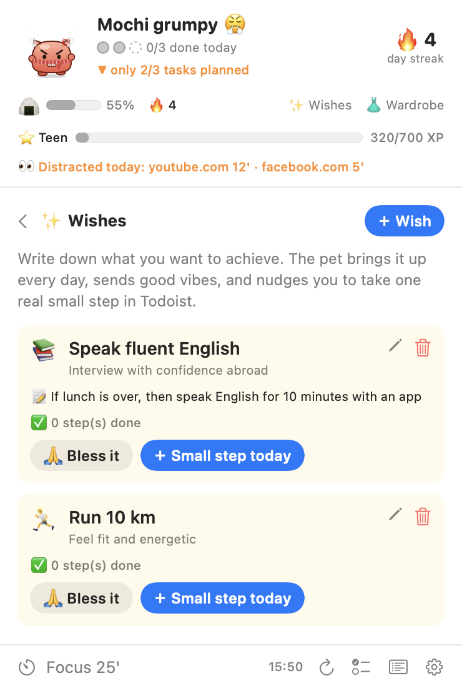 | 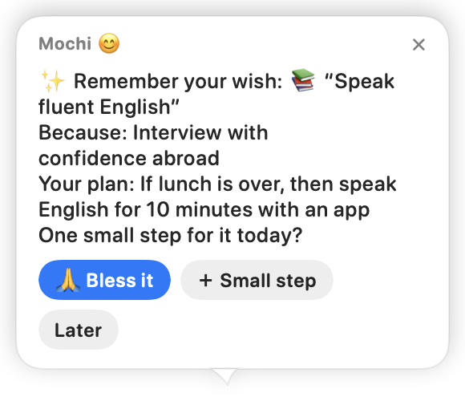 |

### A pet that lives with your work

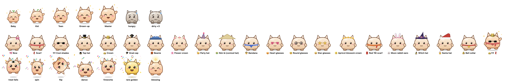

- **Feed it by finishing tasks.** Every finished task drops a treat into its mouth (+25% fullness). Fullness drains about 7% per work hour, so a lazy day leaves it thin, hungry and rumbling. Each workday you do nothing makes it dirtier, up to 3 levels with flies buzzing around, and each finished task washes one layer off. All of this carries over to the next day.
- **Watch it grow.** Tasks earn XP, and the pet grows from Baby (with little leaves on its head) to Kid, Teen, Grown-up and Master.
- **Surprise celebrations.** Each finished task gets a random dance: jump, spin, back-flip or disco. One in ten is a rare golden treat with a golden pet. Finishing tasks within 30 minutes of each other builds a combo (×2, ×3…) worth more XP, ending in fireworks.
- **Unlock things to wear.** The pet earns a bow, scarf, sunglasses, top hat, crown and grad cap through milestones like your first task, a 3-day streak, a ×3 combo, 25 tasks and a 7-day streak. 14 more come from chests (below).
- **Forgiving streaks.** One finished task on a workday keeps your streak. A goal day earns a 🍪 snack (you keep up to 2), and a missed workday eats a snack instead of your streak. A broken streak of 2+ days can be **mended**: finish 2 tasks on a workday within two weeks. Days off, days your Mac was off, and days packed with meetings never count against you.
- **It feels alive.** Rest the cursor on it and it squints and slow-blinks like a content cat, with a little heart. Double-click it and it giggles; keep clicking and it gets dizzy. It shakes itself off after you drag it, waves when you come back, and yawns now and then when things are quiet. None of it happens while you type, focus or meet.
- **Mischief, only while you're distracted.** Three minutes on a distracting site and it sighs and stomps. Grumpy for 10 minutes there, it marches across the screen dragging a sign with the task you're avoiding. Five minutes on YouTube while grumpy and it leaps into the middle of the screen with a (╯°□°)╯︵ ┻━┻. It never plays tricks after a bad day: that only makes things worse. At the end of the day it reports, sulking, how long you spent on distractions. It can also say its lines out loud (off by default).
- **It plays fair.** No mischief during meetings or focus sessions or while you're away. At most one big stunt every 20 minutes. Every stunt has a **Spare me 15'** button, and clicking the pet calls it off. You can turn mischief off in Settings.

### A little game around your work

The game only rewards real work, shows its odds, and never sells anything.

- **Chests.** Every 30 minutes of real work (at the Mac, in work hours, not on a distraction or in a meeting) earns a 🎁, up to 3 a day. Your next finished task opens it: common 70% (XP or a 🍪), rare 25% (a new outfit: beanie, flower crown, party hat, nón lá, bandana, heart, round or star glasses), legendary 5% (a seasonal outfit, or a golden treat).
- **Seasonal outfits.** Apricot blossoms and a red scarf around **Tết**, moon-rabbit ears at **Trung Thu**, a witch hat at **Halloween**, a Santa hat and bell collar at **Christmas**. The wardrobe shows the season and the days left.
- **Knitting while you focus.** During a focus session the pet knits beside you; a 25-minute session makes one decoration (a plant, a lamp, a fishbowl… 12 in all). A distracting site drops a few stitches, never the whole piece. Pick up to 3 for the **home corner**, a little shelf at the bottom-right of the screen (Settings can hide it).
- **Trips.** When today's plan is done with an hour or more of work left, the pet asks to go on a trip (Hội An, Đà Lạt, Kyoto, Paris…). A signpost stands in for it for up to 2 hours, then it comes back with a souvenir for the shelf and a postcard in the diary. Starting a focus session or **Call back** brings it home early (no souvenir under 30 minutes).
- **A sticker book with a head start.** Each page has 10 slots and starts with 2 gifts; every perfect day adds a 🌟, and a full page gives +50 XP and a 🍪.
- **Weekly chapters.** The first greeting of the week opens a new chapter with last week's recap: tasks, stickers and trips.


| Wardrobe | Mischief |
|---|---|
| 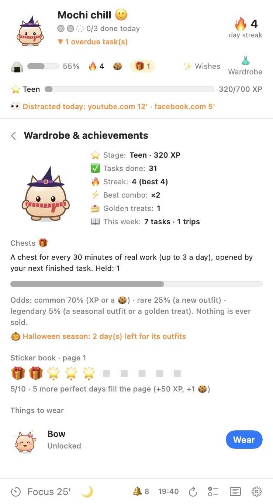 | <br>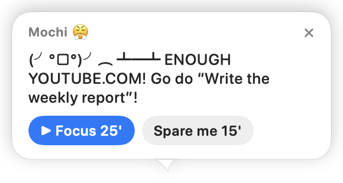 |

| Board | Bubble | Split a task |
|---|---|---|
| 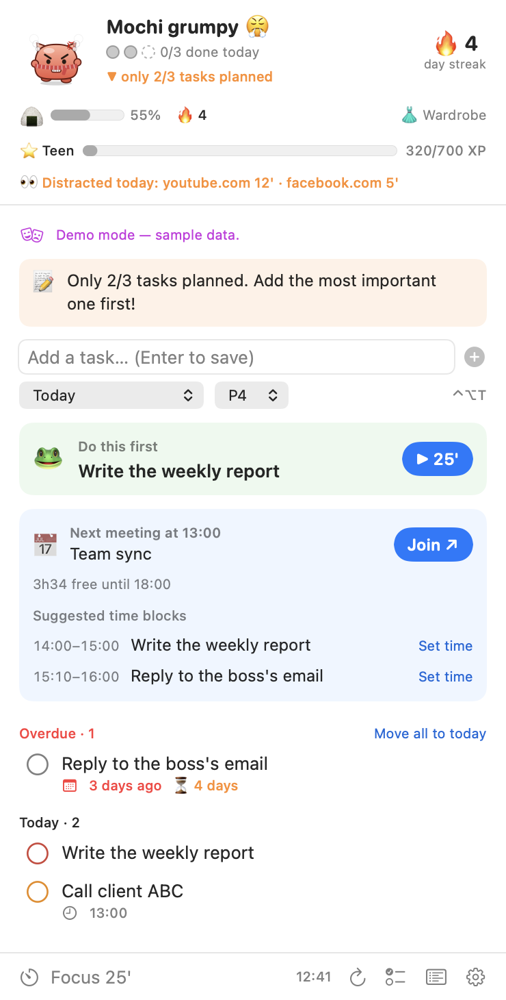 | 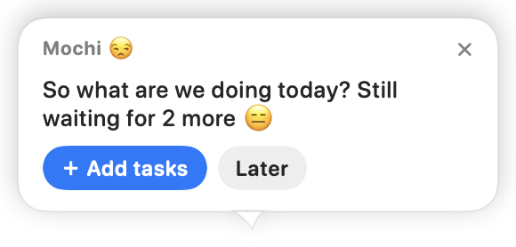<br>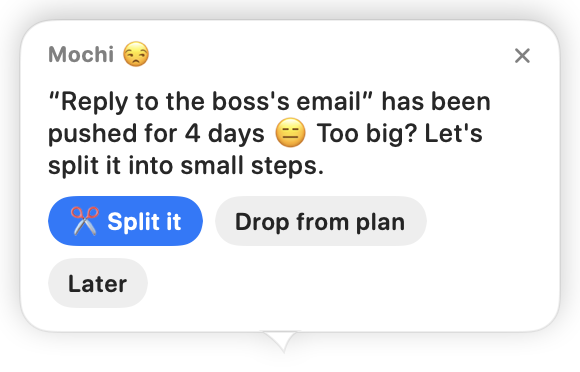 | 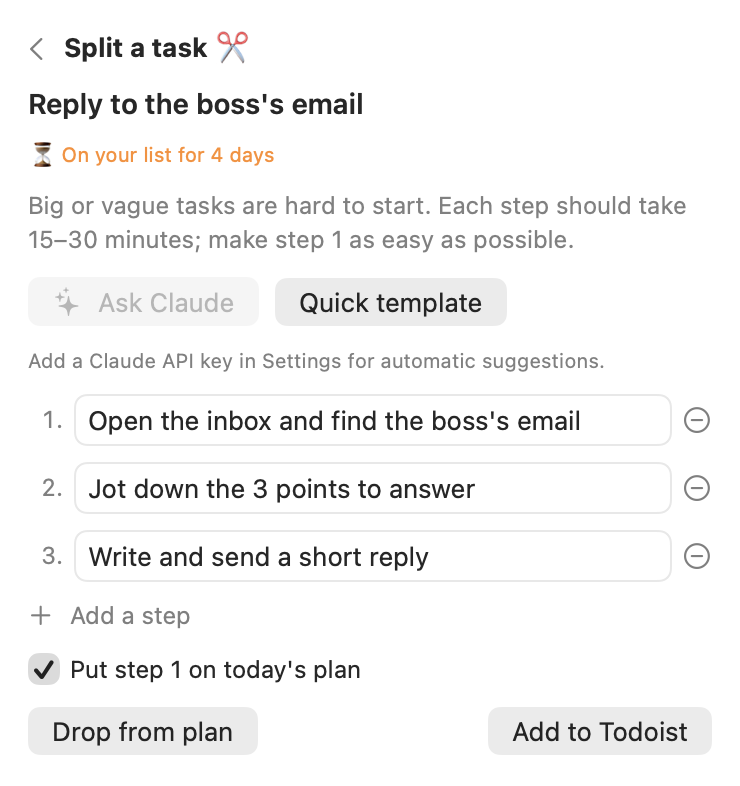 |

| Wrap up | Where was I? · Meeting bookend |
|---|---|
| 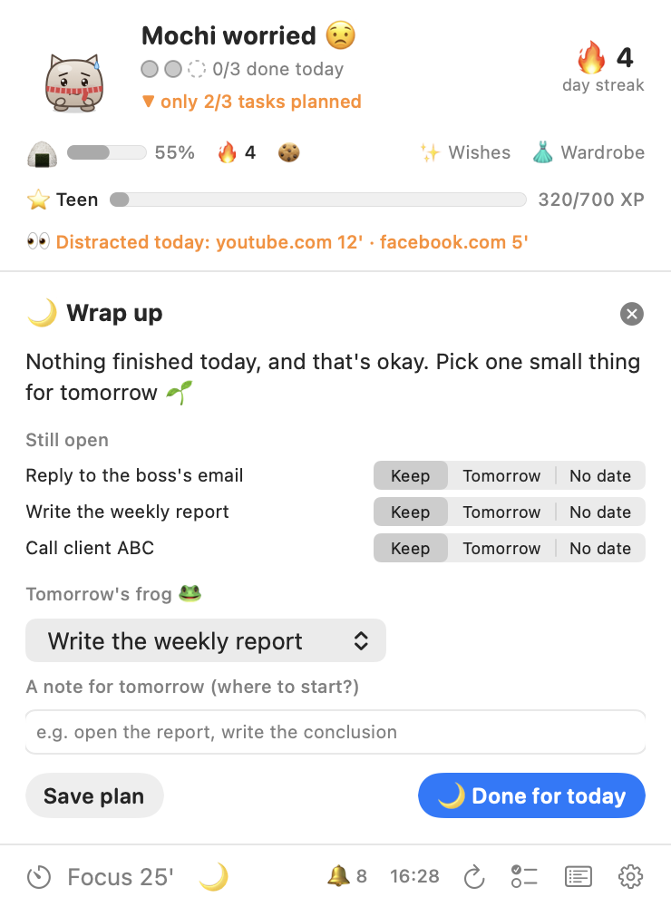 | 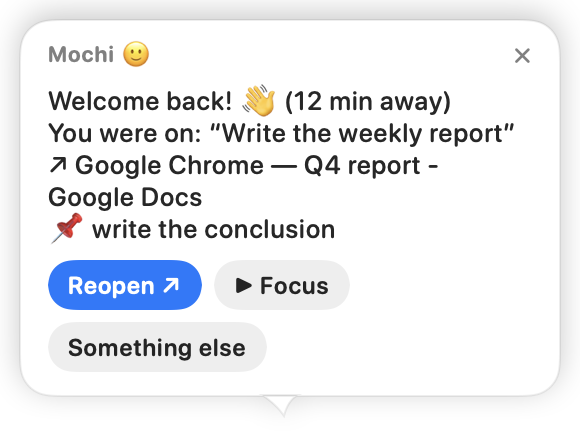<br>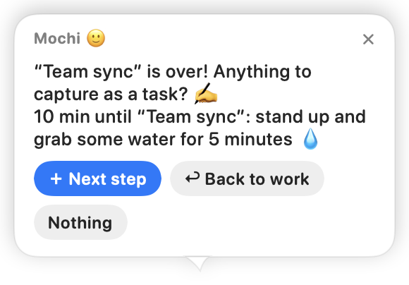 |

## Install

You need macOS 14 or later and the Xcode Command Line Tools (`xcode-select --install`). Xcode itself isn't required.

```bash
git clone https://github.com/trananhtung/todopet.git
cd todopet
scripts/build.sh
cp -R build/TodoPet.app /Applications/
open /Applications/TodoPet.app
```

`UNIVERSAL=1 scripts/build.sh` builds for both Apple silicon and Intel.

**Recommended if you rebuild often:** give your builds a stable signature. macOS ties the Calendar and browser (Automation) permissions to the signature, so they don't have to be granted again after every update. The Keychain is different: for apps without an Apple Developer ID it ties "Always Allow" to the exact build, so it still asks once after each update that changes the code.

```bash
scripts/setup-signing.sh   # creates a "TodoPet Local Signing" certificate in its own keychain
scripts/trust-signing.sh   # marks it trusted for code signing, for your user only (asks for your password)
```

After that `scripts/build.sh` signs with it automatically. To undo, delete `~/Library/Application Support/TodoPet-Signing` and the certificate in Keychain Access.

Want to look around first? Run `open build/TodoPet.app --args --demo` to use sample tasks, no account needed.

## Connect Todoist

1. In Todoist open **Settings → Integrations → Developer** ([direct link](https://app.todoist.com/app/settings/integrations/developer)) and copy your **API token**.
2. Click the pet, paste the token and press **Save & connect**.

The token is stored in your macOS **Keychain** and is only ever sent to `api.todoist.com` (Todoist API v1). After rebuilding the app, macOS may ask once whether TodoPet can read its Keychain item; choose **Always Allow**.

### Permissions macOS will ask for

| Prompt | Why | If you say no |
|---|---|---|
| Calendar | Meetings, free time, time-block suggestions | The board offers an **Allow** button; everything else works |
| "TodoPet wants to control Safari / Chrome…" (once per browser) | Reading the active tab's address for distracting sites | Website detection is off for that browser; app detection still works |

With an ad-hoc signature macOS asks for Calendar and browser access again after every rebuild; with the local signing certificate (see Install) it keeps them. The Keychain asks again whenever the app's code changes; only an Apple Developer ID signature avoids that.

### Splitting tasks with Claude (optional)

Add an Anthropic API key in **Settings → Postponed tasks** ([get one](https://console.anthropic.com/settings/keys)). When you press **Ask Claude** in the split view, the task's title and notes are sent to the Claude API, which returns 3–5 small steps. It uses `claude-opus-5-5` at low effort, with server-side fallback enabled in case a request is declined. Each request costs roughly 1–2 US cents, and you can change the model in Settings. Without a key you can type the steps yourself or start from the quick template.

### Using Todoist from Claude or other AI apps (MCP)

TodoPet talks to Todoist directly with your API token. If you also want to manage tasks by chatting with an AI assistant, connect Todoist's official MCP server at `https://ai.todoist.net/mcp`. In Claude Code that's `claude mcp add --transport http todoist https://ai.todoist.net/mcp`, and in Claude Desktop you add it as a custom connector. Tasks you create there show up on the pet within 3 minutes, or right away when you click it.

## Using it

| Action | What happens |
|---|---|
| Click the pet | Opens the task board |
| Hover a task on the board | ▶︎ focus · ✂️ split · → move · 🗑 delete (asks first; sub-tasks and recurring series go too, and it can't be undone) |
| Drag the pet | Moves it; let go and it drops back to the Dock |
| Hover | It stops walking and blushes |
| Right-click / menu bar icon | Quick menu: add task, focus, hide for 1 hour, quiet for 1 hour, settings |
| <kbd>⌃</kbd><kbd>⌥</kbd><kbd>T</kbd> | Opens the board with the add field focused, from any app |

The menu bar shows the mood and today's progress (`😊 2/3`), or the timer during focus (`🍅 18:42`).

## How the mood works

Mochi keeps a 0–100 happiness score, recalculated every 15 seconds. Hover the reason line on the board to see the breakdown.

| Makes it happier | Makes it worried |
|---|---|
| +8 per task completed today | −7 per overdue task |
| +30 when today's plan is fully done | −4 per task that's past its time |
| Up to +15 right after you finish something | −12 to −50 when fewer than 3 tasks are planned after the planning deadline |
| +10 during a focus session | Up to −30 when nothing moves for more than 90 minutes |
| Meeting time counts as work | Up to −35 after 2+ minutes in a distracting app or website |
| | −3 per task that keeps getting postponed (up to −9) |
| | Up to −15 when it's hungry (below 30% full) |
| | −5 per level of dirt |

Score ≥ 75 is happy, ≥ 50 is chill, and anything lower is worried. It only turns grumpy (below 30) while you're on a distracting app or site in work hours. Outside work hours, at night, during meetings, after **Done for today**, or when you've been away for 10 minutes, it calms down or falls asleep, and it never nags while you're away.

## When it talks

In priority order, at most one bubble at a time:

1. A few minutes before a meeting (even during a focus session), with related tasks, then silence until the meeting ends
2. 10 minutes before, and at the time of, any task with a time
3. Coming back after 5+ minutes away: "where was I?" (or the next task)
4. After a meeting: "anything to capture?", and a breather before the next one
5. A task whose **Start when…** moment has come
6. *(After **Done for today**, nothing below this line.)* A distracting app or website open for more than 2 minutes; back from a 2+ minute detour: "where was I?"
7. Morning greeting with today's plan (or a request to plan), yesterday's frog and note, and a summary of the day's meetings and free time
8. Once a day, an overbooked warning
9. "What are our 3 things today?" every 30 minutes after the planning deadline until there are enough tasks
10. A task that keeps getting postponed: split it, try 2 minutes, or drop it
11. Hungry: begging for a finished task, at most hourly
12. Mischief while you're on a distraction: grumbling, then the sign parade (the table flip comes with rule 6)
13. Overdue tasks, every 90 minutes, with a **Fresh start**
14. Once a day, a time block for the next task
15. Wrap up, then a sulky distraction report if you spent 10+ minutes on distractions
16. A nudge with the next task, every 45 minutes
17. A productivity tip now and then, only when the mood is good

**A daily budget:** at most 8 unsolicited reminders a day (Settings). A reminder you close, or ignore when it has buttons, comes half as often for the rest of the day (up to ×8), and passing on 3 in a row holds the rest for an hour. Meetings, timed tasks, your own **Start when…** plans and check-ins like "where was I?" don't count. The board's footer shows 🔔 how many are left.

All timings are in **Settings**: daily target, work hours, work days, planning deadline, reminder interval, focus and break length, distracting apps and websites, calendar options, when a task counts as postponed, a custom Todoist filter for "my day" (for example `(today | overdue) & #Work`), pet size, sounds, mischief, spoken lines, focus protection, and open at login.

## Designed not to break your focus

A reminder app that interrupts deep work does more harm than good, so the pet follows what interruption research recommends:

| Rule | Why |
|---|---|
| **Interrupt at a pause.** Non-urgent bubbles wait until you stop typing for a few seconds or switch apps. Meeting and due-time reminders still arrive on time. | Interruptions at task boundaries cause less frustration and faster resumption than mid-task ones (Adamczyk & Bailey 2004; Iqbal & Bailey 2008). |
| **Protect deep work.** After 10 minutes of steady typing in work apps the pet shows 🎧, holds everything non-urgent, and counts the time as progress. No grumpiness, no mischief. | Getting back on track after an interruption is slow and stressful (Mark et al. 2008). |
| **Fewer bubbles.** At least 15 minutes between unsolicited bubbles (configurable), one at a time. | Batched, less frequent notifications improve attention and well-being (Fitz et al. 2019). |
| **Keep still while you type.** The pet stops walking and dampens its movements, and walks again when you pause. | Motion at the edge of vision grabs attention involuntarily (Bartram et al. 2003). |
| **Quiet by default.** Sounds are "important only" (meetings, due times, end of focus, finished tasks) and soft. Ordinary bubbles fade in silently. | Calm technology informs from the periphery and only moves to the center when needed (Weiser & Brown 1996). |
| **A reminder budget that backs off.** At most 8 unsolicited reminders a day; the kinds you keep closing come less often. | Notifications batched to a few times a day improved attention and productivity in a 237-person RCT (Fitz et al. 2019). |
| **Mischief targets distraction, not work.** Antics only fire while you're on a distracting app or site, never while you're typing, during meetings or focus sessions, or while you're away. | Punishing slips backfires: a pet that only frets and helps keeps people coming back (Diefenbach & Müssig 2019). |

Sounds have three levels in Settings: **Off**, **Important only** (default) and **Everything**.

### The pet diary

To tune all of this to how you actually work, the pet keeps a diary (the 📜 button on the board, or the menu bar). It records:
- every reminder and the reason it fired
- what you did with it (tapped a button, closed it, or let it fade)
- every reminder it held back (you were in the zone, typing, or it had spoken recently)
- meetings, focus sessions, mood changes with their top reasons, time on distracting sites, feedings and the end-of-day settlement

A summary line shows how many reminders you got and how many you ignored. **Copy** puts the whole day on the clipboard, so you can paste it into Claude and ask for adjustments. The diary stays on your Mac (`~/Library/Application Support/TodoPet/log`), keeps 14 days, and can be turned off in Settings.

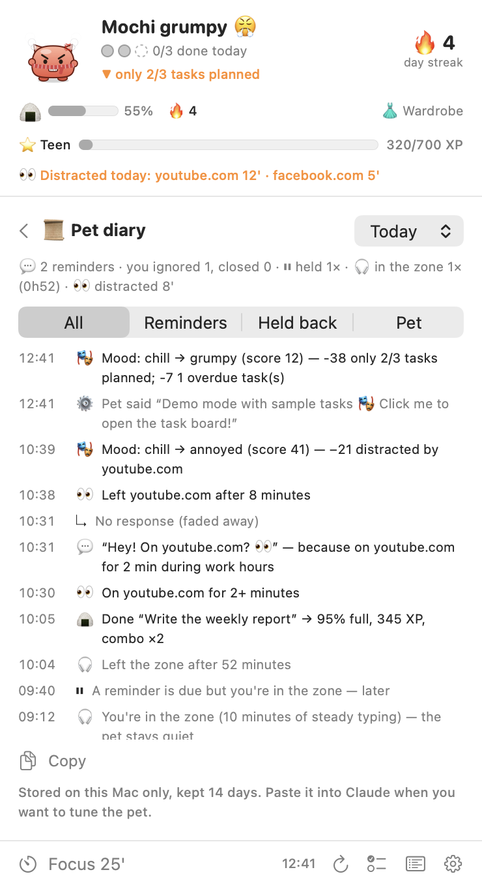

## Why these features

The behavior is based on well-known productivity practices, kept deliberately simple:

- **Rule of 3**: plan three meaningful outcomes per day instead of an endless list (J.D. Meier, *Getting Results the Agile Way*).
- **Eat the frog**: start with the most important task (Brian Tracy).
- **Implementation intentions**: tasks with a concrete time ("at 2pm I'll…") are more likely to get done (Peter Gollwitzer). The pet reminds you right on time.
- **Pomodoro**: short, timed focus blocks with breaks (Francesco Cirillo).
- **Interruptions are expensive**: getting back on task after a switch takes a long time (Gloria Mark's research), so the pet calls out distracting apps and websites and stays silent during focus and meetings.
- **Time blocking**: giving tasks a slot in the calendar protects time for them; the pet finds the slots between your meetings.
- **Procrastination often means the task is too big or vague**: breaking it into a small, concrete first step makes starting easier, so the pet suggests splitting tasks you keep postponing.
- **Shutdown ritual**: close the day by reviewing and rescheduling (Cal Newport).
- **Emotional feedback**: a character that visibly reacts to your progress makes progress feel rewarding, and slacking slightly uncomfortable.
- **Caring for a pet** (the "Tamagotchi effect", used by apps like Finch): you work partly to keep it fed and clean, and the consequences last across days. Losing something you have motivates more than an equal gain.
- **Variable rewards**: unpredictable celebrations and rare golden treats stay exciting longer than a fixed reward, which is why games use them.

## Privacy

- No analytics and no servers of its own. Network traffic goes to `api.todoist.com`, and to `api.anthropic.com` only when you press **Ask Claude**.
- Distraction detection reads the **name of the frontmost app** and, if a browser is in front, the **address and title of its active tab**. They stay in memory and are never stored or sent anywhere. No screen recording or accessibility access is needed.
- The **"where was I?"** card remembers the task, app, page title and address (http/https only, without anything that looks like a token or session) you were on, plus the next step you pin. It lives **in memory only**: never saved, never written to the diary, forgotten at midnight. Private and incognito windows are never remembered, and **Settings** can leave titles and addresses out.
- Your **Start when…** plans and tomorrow's frog and note are saved in the app's local preferences until the day they're for is over.
- The calendar is read locally through macOS (EventKit); events never leave your Mac.
- The "postponed tasks" log is just task IDs and dates in the app's local preferences, and the pet's life (fullness, XP, accessories, today's distraction minutes per site) is stored locally the same way.
- Spoken lines use the voices built into macOS, offline.
- Idle detection only reads "seconds since the last input", which needs no permission.

## Development

```bash
scripts/build.sh                                    # build build/TodoPet.app
build/TodoPet.app/Contents/MacOS/TodoPet --selftest   # logic tests (dates, API parsing, moods)
build/TodoPet.app/Contents/MacOS/TodoPet --demo       # run with sample data
TODOPET_ANTIC=parade build/TodoPet.app/Contents/MacOS/TodoPet --demo   # see the mischief (parade or block) right away
build/TodoPet.app/Contents/MacOS/TodoPet --snapshot out/  # render moods, board and bubble to PNG
```

| File | Role |
|---|---|
| `Brain.swift` | Sync, mood, reminder rules, focus timer, actions |
| `MoodEngine.swift` | Pure scoring function behind the mood |
| `TodoService.swift` | Todoist API v1 client and demo service |
| `BrowserWatcher.swift` | Active-tab address via AppleScript, site rules |
| `CalendarWatcher.swift` | EventKit reader, free-time math, time-block suggestions |
| `StuckTracker.swift` | Log of days each task sat on your list |
| `ClaudeClient.swift` | Messages API call that splits a task into steps |
| `PlanningViews.swift` | Calendar card and split-a-task view |
| `PetLife.swift` | Fullness, dirt, XP and stages, combos, accessories, day settlement |
| `Antics.swift` | Mischief types, the dragged sign, spoken lines |
| `LifeViews.swift` | Life bar and wardrobe & achievements view |
| `Calm.swift` | When it's OK to interrupt: typing pauses, deep-work detection, bubble spacing |
| `PetLog.swift` / `LogView.swift` | The pet diary: entries, daily files, summary, viewer |
| `Wishes.swift` / `WishesView.swift` | Xin vía: wishes, reminders, blessing, small steps |
| `PetArt.swift` | The pet, drawn in code for every mood |
| `PetWindow.swift` | Floating window, walking, drag and drop |
| `Bubble.swift` / `BoardView.swift` / `SettingsView.swift` | UI |
| `Lines.swift` / `L10n.swift` | Everything the pet says, in English and Vietnamese |

It's plain Swift, SwiftUI and AppKit with no dependencies, built with `swiftc`.

## License

[MIT](LICENSE)
