<p align="center">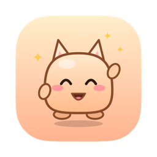</p>

<h1 align="center">TodoPet</h1>

<p align="center">
Một chú pet nhỏ cho macOS, đi dạo trên thanh Dock, đọc công việc từ <a href="https://todoist.com">Todoist</a>,
<b>vui khi bạn làm việc</b> và <b>nổi cáu khi bạn lười</b>.<br>
<a href="README.md">English</a> · Tiếng Việt
</p>

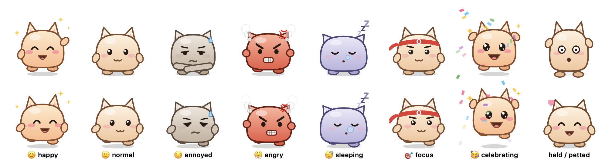

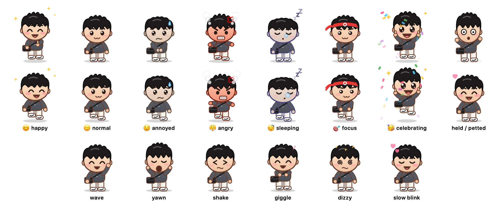

## Pet làm được gì

- **Hai pet để chọn.** **Mochi**, bánh mochi tròn tai mèo, hoặc **Bảnh Bao**, một anh chàng tí hon tóc đen dựng, áo polo xám than, quần trắng, giày thể thao trắng và túi đeo chéo đen, hay giơ ngón cái khi mọi việc suôn sẻ (giơ cả hai khi bạn xong việc). Đổi trong **Cài đặt** hoặc ngay đầu tủ đồ; đồ mặc, tuổi và mọi kỷ niệm của pet vẫn giữ nguyên.
- **Đi dạo trên màn hình.** Pet đi qua đi lại trên Dock, nhìn theo con trỏ, và đứng lại khi bạn rê chuột vào. Kéo thả đi đâu cũng được, thả ra nó sẽ rơi xuống lại.
- **Hỏi "Hôm nay làm gì?".** Nếu hôm nay chưa có đủ **3 việc** (chỉnh được), pet sẽ nhắc bạn lên kế hoạch: buổi sáng hỏi nhẹ nhàng, qua giờ hạn chót thì nhắc gắt dần.
- **Nhắc đúng việc cần làm.** Pet chọn việc tiếp theo theo kiểu "ăn con ếch trước" (ưu tiên cao nhất, rồi giờ sớm nhất), nhắc mỗi 45 phút, và báo trước 10 phút với việc có giờ cụ thể.
- **Có tâm trạng tử tế.** Pet ăn mừng mỗi việc bạn xong (kể cả việc tích trong app Todoist). Khi có việc quá hạn, nhiều giờ không tiến triển hoặc chưa lên kế hoạch, pet **lo lắng** và gợi ý cách gỡ: kéo việc vào hôm nay, **🌱 Bắt đầu lại** (dời hết việc quá hạn sang mai), thử 2 phút, hoặc chia nhỏ việc to. Pet chỉ **nổi cáu** khi bạn ngồi trong app hay trang web gây xao nhãng trong giờ làm, và lúc đó nó hầm hầm đi về phía con trỏ chuột 😤
- **Làm việc với Todoist ngay trên pet.** Bấm vào pet để xem việc hôm nay, tích hoàn thành, thêm việc mới (Hôm nay / Ngày mai / Không hạn, độ ưu tiên, hoặc cú pháp quick-add của Todoist như `Gọi Lan 3pm p1 #Work`), dời việc sang hôm nay hoặc ngày mai, xoá việc (có bước xác nhận, vì Todoist không khôi phục được), và xem chuỗi ngày (streak) trên Todoist.
- **Có hẹn giờ tập trung.** Bắt đầu phiên 25 phút cho một việc, pet đeo băng đô rồi ngồi im trong góc. Hết giờ, pet hỏi bạn xong chưa; nếu xong, pet tự đánh dấu hoàn thành trên Todoist và bắt đầu giờ nghỉ.
- **Cùng bạn đóng ngày.** Từ 15:00 (hoặc 30 phút trước giờ tan làm), nút 🌙 trên bảng việc mở **Đóng ngày**: những việc đã xong, mỗi việc còn dở chọn **Giữ / Mai / Bỏ hạn**, rồi chọn **con ếch cho ngày mai** và để lại một dòng nhắn cho chính mình. **Xong ngày hôm nay** cho pet đi ngủ tới đầu giờ làm hôm sau (họp và việc có giờ vẫn nhắc). Sáng hôm sau, lời chào nhắc lại con ếch và lời nhắn, và con ếch được xếp lên đầu.
- **Bắt quả tang trang web gây xao nhãng.** Pet đọc tab đang mở trong Safari, Chrome, Arc, Edge, Brave, Cốc Cốc và các trình duyệt Chromium khác. Ngồi YouTube hay Facebook quá 2 phút trong giờ làm là pet bắt đầu nhăn nhó. Bạn tự chọn danh sách trang; quy tắc như `youtube.com/shorts` chỉ bắt đúng một phần của trang.
- **Biết lịch họp của bạn.** Pet đọc các sự kiện hôm nay từ Lịch của macOS (gồm cả tài khoản Google, Outlook đã thêm vào Lịch). Pet nhắc trước giờ họp 5 phút kèm nút **Vào họp**, im lặng khi bạn đang họp, và không tính giờ họp là lười. Ngày nào họp nhiều thì pet hạ mục tiêu, khoảng 2 giờ trống cho 1 việc quan trọng.
- **Gợi ý khung giờ.** Pet xếp các việc tiếp theo vào khoảng trống trong ngày ("10:00–11:00 Viết báo cáo"). Một cú bấm là đặt giờ đó cho việc trong Todoist, và pet sẽ nhắc bạn đúng giờ.
- **Phát hiện việc bị dời mãi.** Việc nào nằm trong danh sách từ 3 ngày trở lên, pet hỏi bạn muốn chia nhỏ hay bỏ khỏi kế hoạch. Chia nhỏ là tách thành các bước 15–30 phút, thêm vào Todoist dưới dạng việc con, bước 1 vào kế hoạch hôm nay. Nếu có API key Claude, nút **Nhờ Claude gợi ý** sẽ đề xuất các bước giúp bạn.
- **"Mình đang làm dở gì nhỉ?"** Sau khi bạn rời máy 5 phút trở lên, sau một cuộc họp, hoặc sau 2 phút lạc sang trang gây xao nhãng, pet cho bạn xem mình đang làm gì: việc, ứng dụng và trang, kèm nút **Mở lại ↗** (đúng tab đó, đúng trình duyệt đó), **Tập trung** và **Việc khác**. Nút **📌 Ghim chỗ đang làm** trên bảng việc giữ chỗ của bạn kèm một dòng "bước tiếp theo". Tất cả chỉ nằm trong bộ nhớ, không bao giờ ghi trang của cửa sổ ẩn danh, và tối đa 30 phút hiện một lần.
- **Kẹp hai đầu cuộc họp.** Bong bóng "sắp họp" liệt kê tối đa 2 việc có chữ trùng với tên cuộc họp. Họp từ 15 phút trở lên thì sau họp pet hỏi **Có gì cần ghi lại không?** (nút **＋ Việc tiếp theo** mở ô thêm việc có sẵn tên cuộc họp), và gợi ý nghỉ 5 phút nếu cuộc họp sau đã gần.
- **Hẹn "nếu… thì bắt đầu" và bước khởi động 2 phút.** Menu **⋯** của mỗi việc có **Bắt đầu khi…** (sau một cuộc họp hôm nay, khi mở một ứng dụng bạn vừa dùng, hoặc sau bữa trưa) và **⏱ Thử 2 phút**: một phiên siêu ngắn chỉ để "mở nó ra", hết giờ pet hỏi làm tiếp một phiên hay "thế là đủ".
- **Cảnh báo quá tải và dải thời gian.** Bảng việc hiện ngày làm việc thành một dải mỏng (họp, việc có giờ, bây giờ) kèm "~6h việc & họp / còn 7h". Mỗi ngày một lần, nếu việc cộng với họp còn lại vượt thời gian còn lại từ 1 giờ trở lên, pet nói cho bạn biết và mời **Chọn việc để dời**. Việc chưa có thời lượng trong Todoist được tính 30 phút (chỉnh trong Cài đặt).
- **Nói tiếng Việt và tiếng Anh**, đổi trong Cài đặt.

### Xin vía: điều bạn mong muốn, được nhắc đi nhắc lại

Ghi lại những điều bạn muốn đạt được (nút ✨ trên bảng việc): nói tiếng Anh trôi chảy, chạy 10 km, tiết kiệm mua nhà… Sau đó pet sẽ:
- **nhắc một điều ước 2 lần mỗi ngày** (chỉnh được 0–4 lần), rải đều trong giờ làm và tuân theo cùng luật "không làm mất tập trung" như mọi lời nhắc khác; lời chào buổi sáng cũng nhắc "vía hôm nay"
- **🙏 Xin vía**: pet bay lên, nâng ngôi sao phát sáng và truyền vía cho bạn
- **＋ Bước nhỏ**: gõ một bước cụ thể, bước đó thành việc hôm nay trong Todoist (đánh dấu ✨ và ghi rõ thuộc điều ước nào). Xong việc đó, pet báo "vía về rồi" và cộng bước vào điều ước

Mỗi điều ước còn có thể ghi kết quả bạn hình dung, trở ngại lớn nhất trong bạn và kế hoạch "nếu… thì…". Đó là phương pháp WOOP (Gabriele Oettingen): chỉ mơ tưởng tích cực thường làm giảm động lực, còn hình dung kết quả, gọi tên trở ngại và lập kế hoạch cho nó giúp người ta làm được nhiều hơn. Vì vậy lời nhắc nào cũng kết thúc bằng một bước nhỏ, không chỉ là một suy nghĩ đẹp. Điều ước chỉ lưu trên máy bạn.

| Xin vía | Lời nhắc vía |
|---|---|
| 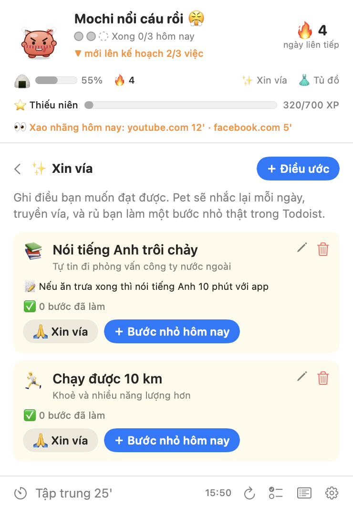 | 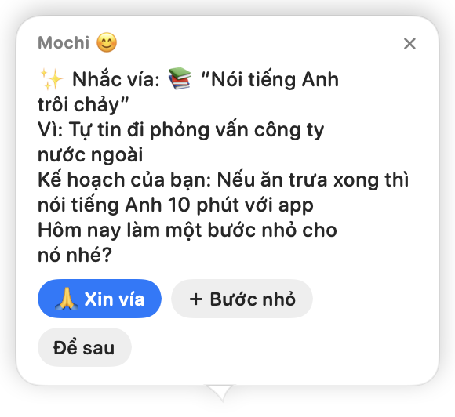 |

### Một chú pet sống cùng công việc của bạn

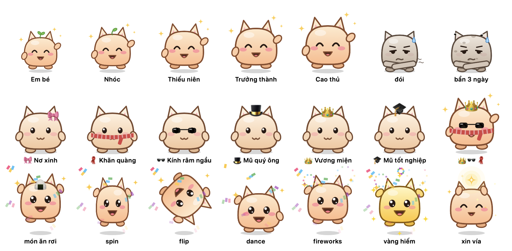

- **Làm xong việc là cho pet ăn.** Mỗi việc xong là một món ngon rơi vào miệng pet (+25% độ no). Độ no giảm khoảng 7% mỗi giờ làm việc, nên lười cả ngày thì pet gầy, đói, bụng réo. Mỗi ngày làm việc mà không xong việc nào, pet bẩn thêm một lớp, tối đa 3 lớp, kèm ruồi bay quanh. Mỗi việc xong tắm sạch một lớp. Tất cả giữ nguyên sang ngày hôm sau.
- **Nhìn pet lớn lên.** Việc xong cho XP, và pet lớn dần từ Em bé (có mầm lá trên đầu) lên Nhóc, Thiếu niên, Trưởng thành, Cao thủ.
- **Ăn mừng bất ngờ.** Mỗi việc xong là một kiểu ngẫu nhiên: nhảy, xoay, lộn nhào, nhảy disco. 1/10 lần là bánh vàng hiếm, pet hoá vàng. Xong việc liên tiếp trong vòng 30 phút sẽ thành combo ×2, ×3…, nhiều XP hơn, và kết bằng pháo hoa.
- **Mở khoá đồ để mặc.** Nơ, khăn, kính râm, mũ quý ông, vương miện, mũ tốt nghiệp, mở theo các cột mốc: việc đầu tiên, chuỗi 3 ngày, combo ×3, 25 việc, chuỗi 7 ngày… Thêm 14 món nữa đến từ rương quà (xem bên dưới).
- **Chuỗi ngày biết tha thứ.** Chỉ cần xong 1 việc trong ngày làm việc là giữ chuỗi. Ngày đạt mục tiêu được thêm một 🍪 bánh (giữ tối đa 2), lỡ một ngày làm việc thì pet ăn bánh thay vì làm đứt chuỗi. Chuỗi từ 2 ngày bị đứt vẫn **nối lại được**: xong 2 việc trong một ngày làm việc trong vòng 2 tuần. Ngày nghỉ, ngày tắt máy và ngày họp kín lịch không bao giờ bị tính là lười.
- **Pet như đang sống.** Để con trỏ nằm yên trên pet, nó nheo mắt rồi chớp chậm như mèo được vuốt, kèm một trái tim nhỏ. Bấm đúp, pet cười khúc khích; bấm tiếp, pet chóng mặt. Kéo thả xong nó rũ mình, bạn quay lại thì nó vẫy tay, lúc yên ắng thỉnh thoảng nó ngáp. Không trò nào diễn ra khi bạn đang gõ phím, tập trung hay họp.
- **Chỉ quậy khi bạn đang xao nhãng.** Ngồi trang gây xao nhãng 3 phút là pet thở dài, giậm chân. Cáu ở đó 10 phút thì pet diễu hành ngang màn hình, kéo theo tấm biển ghi tên việc bạn đang né. Đang cáu mà ngồi YouTube 5 phút thì pet nhảy lên giữa màn hình kèm (╯°□°)╯︵ ┻━┻. Pet không bao giờ quậy sau một ngày tệ, vì như thế chỉ làm bạn nản hơn. Cuối ngày, pet hờn dỗi báo bạn đã lướt mạng bao lâu. Pet có thể nói thành tiếng bằng giọng Linh của macOS (mặc định tắt).
- **Quậy có luật.** Không quậy khi bạn đang họp, đang tập trung hay đã rời máy. Trò lớn tối đa 20 phút một lần. Mỗi trò có nút **Tha cho tôi 15'**, và bấm vào pet là pet thôi quậy. Bạn có thể tắt hẳn trò quậy trong Cài đặt.

### Một trò chơi nhỏ quanh công việc

Trò chơi chỉ thưởng cho việc làm thật, công khai tỉ lệ, và không bán gì cả.

- **Rương quà.** Mỗi 30 phút làm việc thật (ngồi máy, trong giờ làm, không ở trang xao nhãng hay trong cuộc họp) được một 🎁, tối đa 3 rương mỗi ngày. Việc xong tiếp theo sẽ mở rương: thường 70% (XP hoặc 🍪), hiếm 25% (đồ mới: mũ len, vòng hoa, mũ tiệc, nón lá, khăn bandana, kính trái tim, kính tròn, kính ngôi sao), huyền thoại 5% (đồ theo mùa, hoặc bánh vàng).
- **Đồ theo mùa.** Vòng hoa mai và khăn đỏ dịp **Tết**, băng đô thỏ ngọc dịp **Trung Thu**, mũ phù thuỷ dịp **Halloween**, mũ Noel và vòng cổ chuông dịp **Giáng sinh**. Tủ đồ cho biết đang mùa nào và còn bao nhiêu ngày.
- **Đan len khi bạn tập trung.** Trong phiên tập trung, pet ngồi đan len cạnh bạn; một phiên 25 phút được một món trang trí (chậu cây, đèn dầu, bể cá… tổng 12 món). Mở trang xao nhãng thì tuột vài mũi, không bao giờ mất cả món. Chọn tối đa 3 món bày ở **góc nhà**, một kệ nhỏ ở góc dưới bên phải màn hình (tắt được trong Cài đặt).
- **Đi phiêu lưu.** Xong hết kế hoạch mà còn từ 1 giờ làm việc trở lên, pet xin đi chơi (Hội An, Đà Lạt, Kyoto, Paris…). Một tấm biển đứng thay pet tối đa 2 giờ, rồi pet về mang theo quà lưu niệm cho kệ và một tấm bưu thiếp trong nhật ký. Bắt đầu phiên tập trung hoặc bấm **Gọi về** thì pet về sớm (dưới 30 phút thì chưa có quà).
- **Sổ sticker có sẵn tiến độ.** Mỗi trang 10 ô, mở đầu bằng 2 ô quà; mỗi ngày làm trọn kế hoạch thêm một 🌟, đầy trang được +50 XP và một 🍪.
- **Chương truyện hằng tuần.** Lời chào đầu tiên của tuần mở một chương mới, kèm tóm tắt tuần trước: số việc, sticker và chuyến đi.

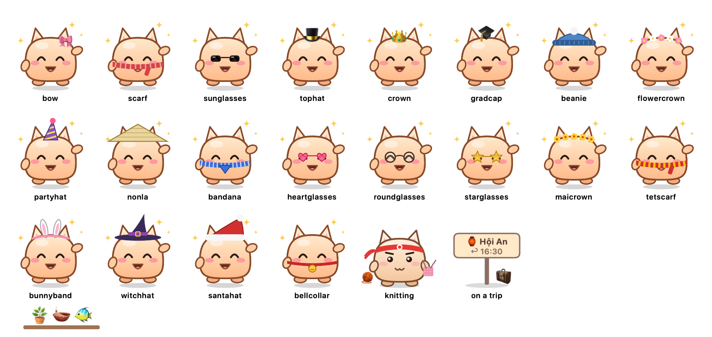

| Tủ đồ | Trò quậy |
|---|---|
| 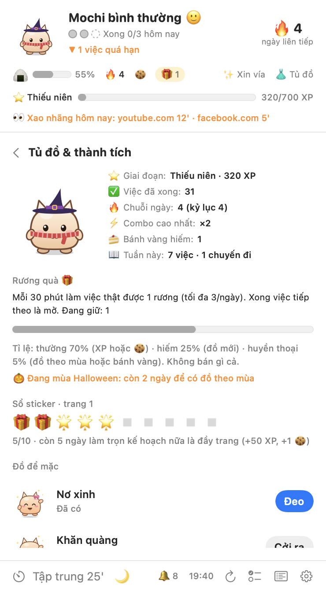 | <br>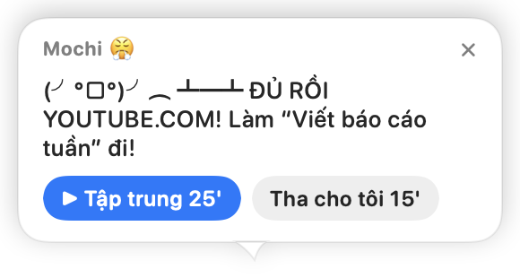 |

| Bảng việc | Bong bóng thoại | Chia nhỏ việc |
|---|---|---|
| 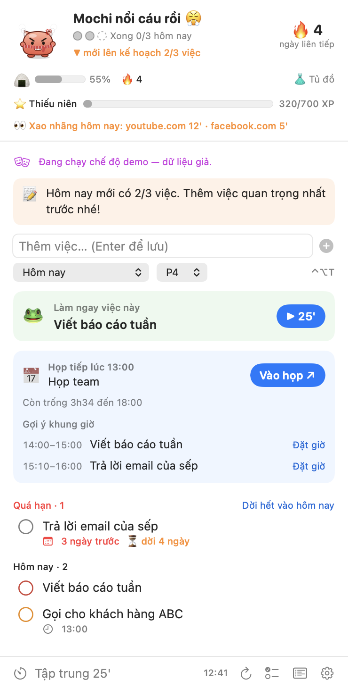 | 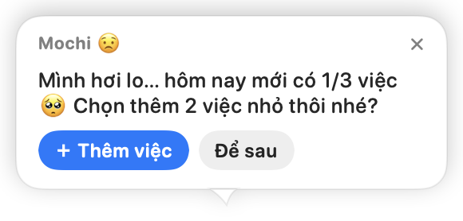<br>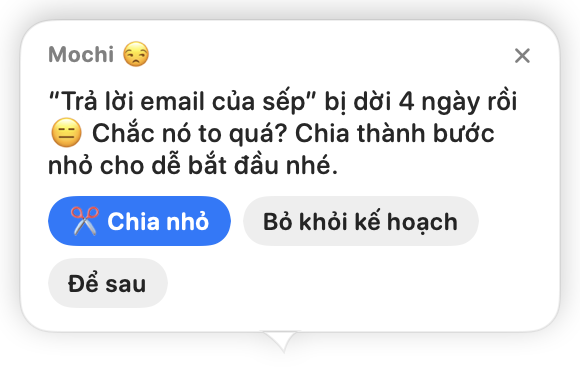 | 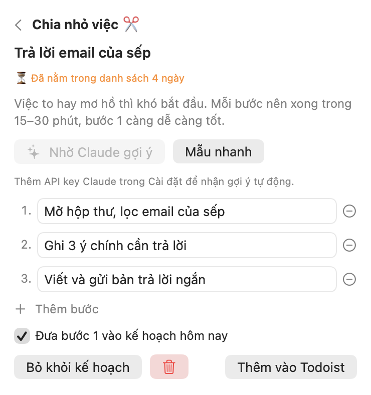 |

| Đóng ngày | Đang làm dở gì · Sau cuộc họp |
|---|---|
| 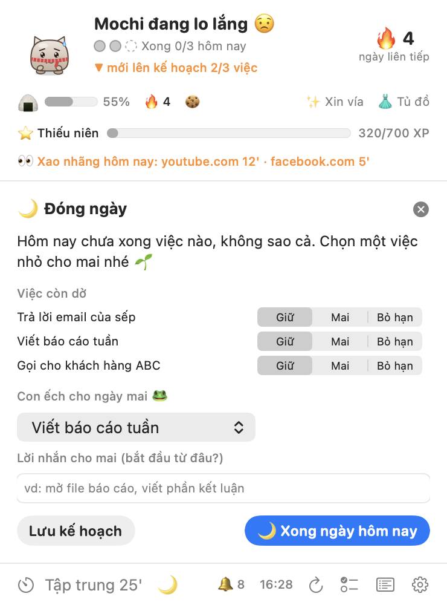 | 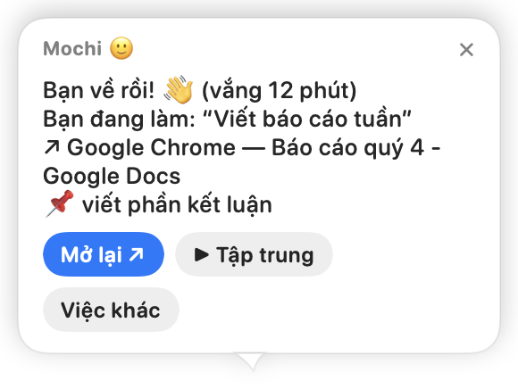<br> |

## Cài đặt

Cần macOS 14 trở lên và Xcode Command Line Tools (`xcode-select --install`). Không cần cài Xcode.

```bash
git clone https://github.com/trananhtung/todopet.git
cd todopet
scripts/build.sh
cp -R build/TodoPet.app /Applications/
open /Applications/TodoPet.app
```

`UNIVERSAL=1 scripts/build.sh` build cho cả chip Apple và Intel.

**Nên làm nếu bạn hay build lại:** cho các bản build một chữ ký cố định. macOS gắn quyền Lịch và quyền điều khiển trình duyệt vào chữ ký, nên không phải cấp lại sau mỗi lần cập nhật. Keychain thì khác: với app không có Apple Developer ID, "Luôn cho phép" bị gắn vào đúng bản build, nên mỗi lần cập nhật có thay đổi code Keychain vẫn hỏi lại một lần.

```bash
scripts/setup-signing.sh   # tạo chứng chỉ "TodoPet Local Signing" trong một keychain riêng
scripts/trust-signing.sh   # đánh dấu tin cậy để ký code, chỉ cho tài khoản của bạn (macOS hỏi mật khẩu)
```

Sau đó `scripts/build.sh` tự ký bằng chứng chỉ này. Muốn gỡ: xoá thư mục `~/Library/Application Support/TodoPet-Signing` và chứng chỉ trong Keychain Access.

Muốn xem thử trước? Chạy `open build/TodoPet.app --args --demo` để dùng dữ liệu mẫu, không cần tài khoản.

## Kết nối Todoist

1. Trong Todoist, vào **Cài đặt → Tích hợp → Developer** ([link thẳng](https://app.todoist.com/app/settings/integrations/developer)) và sao chép **API token**.
2. Bấm vào pet, dán token rồi bấm **Lưu & kết nối**.

Token được lưu trong **Keychain** của macOS và chỉ được gửi tới `api.todoist.com` (Todoist API v1). Sau khi build lại app, macOS có thể hỏi một lần xem TodoPet có được đọc Keychain không; chọn **Luôn cho phép**.

### Các quyền macOS sẽ hỏi

| Hộp thoại | Để làm gì | Nếu bạn từ chối |
|---|---|---|
| Lịch | Giờ họp, giờ trống, gợi ý khung giờ | Bảng việc hiện nút **Cho phép**; các tính năng khác vẫn chạy |
| "TodoPet muốn điều khiển Safari / Chrome…" (mỗi trình duyệt một lần) | Đọc địa chỉ tab đang mở để bắt trang gây xao nhãng | Tắt phát hiện trang web cho trình duyệt đó; phát hiện app vẫn chạy |

Với chữ ký ad-hoc, macOS hỏi lại quyền Lịch và trình duyệt sau mỗi lần build; với chứng chỉ ký riêng (xem phần Cài đặt) thì giữ nguyên. Keychain vẫn hỏi lại mỗi khi code của app thay đổi; chỉ chữ ký Apple Developer ID mới tránh được.

### Chia nhỏ việc bằng Claude (tuỳ chọn)

Thêm API key Anthropic trong **Cài đặt → Việc bị dời mãi** ([lấy key](https://console.anthropic.com/settings/keys)). Khi bạn bấm **Nhờ Claude gợi ý**, tên và ghi chú của việc được gửi tới Claude API, và Claude trả về 3–5 bước nhỏ. App dùng `claude-opus-5-5` ở mức effort thấp, có bật fallback phía máy chủ phòng khi yêu cầu bị từ chối. Mỗi lần khoảng 1–2 xu Mỹ; bạn đổi được model trong Cài đặt. Không có key thì bạn vẫn tự gõ các bước hoặc dùng mẫu nhanh.

### Huấn luyện viên Claude: lời nhắc viết riêng cho bạn, gắt tuỳ ý (tuỳ chọn)

Với cùng API key, bật **Cài đặt → Huấn luyện viên Claude**, Claude sẽ viết từng lời nhắc theo đúng những gì đang diễn ra: việc bạn đang né, bao lâu rồi chưa có tiến triển, trang bạn đang lướt, bạn đã lờ bao nhiêu lời nhắc. Mỗi lần bạn lờ đi, lời nhắc sau sẽ gắt hơn.

- **Độ gắt:** *Nhẹ nhàng*, *Thẳng thắn*, hoặc *Gắt 🔥*: một huấn luyện viên kiểu trung sĩ, đánh thẳng vào sự trì hoãn và mọi lý do bào chữa (không xúc phạm con người bạn, không chửi thề).
- **Model:** Claude Opus 5.5 (mặc định, hay nhất, ≈ $0.01 mỗi lời nhắc), Claude Sonnet 5.5 (≈ $0.005) hoặc Claude Haiku 5.5 (nhanh và rẻ nhất, ≈ $0.0003). Ước tính theo bảng giá của Anthropic cho một yêu cầu ngắn ở mức effort thấp.
- **Nhắc liên tục (nghiêm khắc):** nhắc dày gấp đôi (nhắc việc tiếp theo tối đa 20 phút một lần, ít nhất 30 lời nhắc mỗi ngày), và bạn có lờ đi thì pet cũng không thưa bớt hay tạm im.
- Nút **Thử một câu** cho xem ngay huấn luyện viên sẽ nói gì lúc này.

Claude viết lại các lời nhắc có tính vào ngân sách (việc tiếp theo, lên kế hoạch, quá hạn, xao nhãng, trò quậy, việc bị dời mãi, đói, chào khi quay lại); lời nhắc họp và việc có giờ giữ nguyên câu chữ, và không gì chen vào lúc bạn đang họp, đang tập trung hay đang gõ phím liền mạch. Nếu Claude chậm hoặc lỗi, pet dùng câu của chính nó. Tối đa 80 lời nhắc do Claude viết mỗi ngày. Mỗi yêu cầu là một lượt gọi ngắn, effort thấp, trả về JSON (có dự phòng khi bị từ chối với Opus và Sonnet), và gửi tên việc, số việc và tên trang đang xao nhãng tới `api.anthropic.com`.

### Dùng Todoist qua Claude hoặc AI khác (MCP)

TodoPet nói chuyện trực tiếp với Todoist bằng API token. Nếu bạn muốn quản lý việc bằng cách chat với trợ lý AI, hãy kết nối MCP server chính thức của Todoist tại `https://ai.todoist.net/mcp`. Với Claude Code: `claude mcp add --transport http todoist https://ai.todoist.net/mcp`; với Claude Desktop thì thêm làm custom connector. Việc tạo ở đó sẽ hiện trên pet trong vòng 3 phút, hoặc ngay khi bạn bấm vào pet.

## Cách dùng

| Thao tác | Kết quả |
|---|---|
| Bấm vào pet | Mở bảng việc |
| Rê chuột vào một việc trên bảng | ▶︎ tập trung · ✂️ chia nhỏ · → dời · 🗑 xoá (hỏi lại trước khi xoá; việc con và cả chuỗi lặp lại cũng bị xoá, không hoàn tác được) |
| Kéo pet | Di chuyển; thả ra pet rơi xuống Dock |
| Rê chuột vào | Pet đứng lại và đỏ mặt |
| Chuột phải / biểu tượng trên thanh menu | Menu nhanh: thêm việc, tập trung, ẩn 1 giờ, im lặng 1 giờ, cài đặt |
| <kbd>⌃</kbd><kbd>⌥</kbd><kbd>T</kbd> | Mở bảng việc với ô thêm việc sẵn sàng, từ bất kỳ app nào |

Thanh menu hiện tâm trạng và tiến độ hôm nay (`😊 2/3`), hoặc đồng hồ khi đang tập trung (`🍅 18:42`).

## Tâm trạng được tính thế nào

Mochi có điểm hạnh phúc từ 0 đến 100, tính lại mỗi 15 giây. Rê chuột vào dòng lý do trên bảng việc để xem chi tiết.

| Làm pet vui hơn | Làm pet lo hơn |
|---|---|
| +8 cho mỗi việc xong hôm nay | −7 cho mỗi việc quá hạn |
| +30 khi xong hết kế hoạch hôm nay | −4 cho mỗi việc đã trễ giờ |
| Tới +15 ngay sau khi bạn xong một việc | −12 đến −50 khi qua hạn lên kế hoạch mà chưa đủ 3 việc |
| +10 khi đang tập trung | Tới −30 khi hơn 90 phút không có tiến triển |
| Giờ họp được tính là làm việc | Tới −35 khi ở trong app hoặc trang web gây xao nhãng hơn 2 phút |
| | −3 cho mỗi việc bị dời mãi (tối đa −9) |
| | Tới −15 khi pet đói (dưới 30% no) |
| | −5 cho mỗi lớp bẩn |

Từ 75 điểm là vui, từ 50 là bình thường, thấp hơn là lo lắng. Pet chỉ nổi cáu (dưới 30 điểm) khi bạn đang ở app hay trang gây xao nhãng trong giờ làm. Ngoài giờ làm, ban đêm, khi đang họp, sau khi bấm **Xong ngày hôm nay**, hoặc khi bạn rời máy 10 phút, pet dịu lại hoặc ngủ, và không bao giờ cằn nhằn lúc bạn vắng mặt.

## Khi nào pet lên tiếng

Theo thứ tự ưu tiên, mỗi lúc chỉ một bong bóng:

1. Vài phút trước giờ họp (kể cả khi đang tập trung), kèm các việc liên quan, sau đó im lặng tới khi họp xong
2. 10 phút trước và đúng giờ của việc có giờ cụ thể
3. Bạn quay lại sau 5 phút trở lên: "mình đang làm dở gì nhỉ?" (hoặc việc tiếp theo)
4. Sau cuộc họp: "có gì cần ghi lại không?", kèm gợi ý nghỉ trước cuộc họp sau
5. Việc có hẹn **Bắt đầu khi…** đã tới lúc
6. *(Sau khi bấm **Xong ngày hôm nay** thì không còn gì từ đây trở xuống.)* Mở app hoặc trang web gây xao nhãng quá 2 phút; vừa rời trang đó sau 2 phút trở lên: "mình đang làm dở gì nhỉ?"
7. Chào buổi sáng kèm kế hoạch hôm nay (hoặc nhắc lên kế hoạch), con ếch và lời nhắn từ hôm qua, tóm tắt lịch họp và giờ trống
8. Mỗi ngày một lần, cảnh báo quá tải
9. "Hôm nay mình làm 3 việc gì nào?" mỗi 30 phút sau hạn lên kế hoạch, cho tới khi đủ việc
10. Việc bị dời mãi: chia nhỏ, thử 2 phút, hay bỏ khỏi kế hoạch
11. Đói: xin bạn xong một việc, tối đa mỗi giờ một lần
12. Quậy khi bạn đang xao nhãng: càu nhàu, rồi diễu hành với tấm biển (trò lật bàn đi kèm mục 6)
13. Việc quá hạn, mỗi 90 phút, kèm nút **Bắt đầu lại**
14. Mỗi ngày một lần, gợi ý khung giờ cho việc tiếp theo
15. Đóng ngày, rồi báo cáo hờn dỗi nếu bạn xao nhãng từ 10 phút trở lên
16. Nhắc việc tiếp theo, mỗi 45 phút
17. Thỉnh thoảng một mẹo năng suất, chỉ khi pet đang vui

**Ngân sách nhắc mỗi ngày:** tối đa 8 lời nhắc tự phát mỗi ngày (chỉnh trong Cài đặt). Lời nhắc nào bạn đóng, hoặc để tự ẩn khi nó có nút bấm, sẽ thưa đi một nửa trong phần còn lại của ngày (tới ×8), và bỏ qua 3 lời nhắc liên tiếp thì pet im 1 giờ. Họp, việc có giờ, hẹn **Bắt đầu khi…** của chính bạn và các thẻ như "mình đang làm dở gì" không bị tính. Chân bảng việc hiện 🔔 số lượt còn lại.

Mọi mốc thời gian đều chỉnh được trong **Cài đặt**: số việc mỗi ngày, giờ làm, ngày làm việc, hạn lên kế hoạch, khoảng nhắc, độ dài phiên tập trung và giờ nghỉ, app và trang web gây xao nhãng, tuỳ chọn Lịch, sau bao nhiêu ngày thì tính là bị dời mãi, bộ lọc Todoist riêng cho "việc của tôi" (ví dụ `(today | overdue) & #Work`), kích thước pet, âm thanh, trò quậy, giọng nói, bảo vệ tập trung, và mở cùng macOS.

## Thiết kế để không làm bạn mất tập trung

Một app nhắc việc mà cắt ngang lúc bạn đang tập trung thì hại nhiều hơn lợi. Vì vậy pet làm theo các khuyến nghị từ nghiên cứu về sự gián đoạn:

| Nguyên tắc | Vì sao |
|---|---|
| **Chỉ ngắt ở điểm nghỉ.** Lời nhắc không gấp đợi tới khi bạn ngừng gõ vài giây hoặc chuyển app. Nhắc họp và việc tới giờ vẫn đến đúng lúc. | Bị ngắt ở ranh giới giữa các việc đỡ bực và quay lại việc nhanh hơn bị ngắt giữa chừng (Adamczyk & Bailey 2004; Iqbal & Bailey 2008). |
| **Bảo vệ lúc vào guồng.** Gõ phím đều đặn 10 phút trong app làm việc thì pet hiện 🎧, giữ lại mọi lời nhắc không gấp và tính thời gian đó là tiến độ. Không nhăn nhó, không quậy. | Quay lại mạch làm việc sau khi bị ngắt rất chậm và gây căng thẳng (Mark và cộng sự 2008). |
| **Ít bong bóng hơn.** Hai lời nhắc tự phát cách nhau ít nhất 15 phút (chỉnh được), mỗi lúc một cái. | Thông báo được gom lại, ít hơn giúp tập trung và dễ chịu hơn (Fitz và cộng sự 2019). |
| **Đứng yên khi bạn gõ phím.** Pet thôi đi lại, cử động nhẹ đi; khi bạn nghỉ tay pet mới đi tiếp. | Chuyển động ở rìa tầm mắt kéo sự chú ý một cách vô thức (Bartram và cộng sự 2003). |
| **Mặc định yên lặng.** Âm thanh để ở mức "chỉ khi quan trọng" (sắp họp, việc tới giờ, hết phiên tập trung, xong việc) và nhỏ. Bong bóng thường hiện lặng lẽ, mờ dần vào. | "Calm technology": báo tin ở vùng ngoại vi, chỉ chiếm trung tâm khi thật cần (Weiser & Brown 1996). |
| **Ngân sách nhắc tự lùi.** Tối đa 8 lời nhắc tự phát mỗi ngày; loại nào bạn hay đóng thì thưa dần. | Gom thông báo lại vài lần mỗi ngày giúp tập trung và năng suất hơn trong một thử nghiệm với 237 người (Fitz và cộng sự 2019). |
| **Chỉ quậy khi bạn xao nhãng, không quậy khi bạn làm.** Trò quậy chỉ xảy ra khi bạn đang ở app hay trang gây xao nhãng; không bao giờ khi bạn đang gõ phím, đang họp, đang tập trung hoặc đã rời máy. | Phạt khi người dùng trượt thì phản tác dụng; một con pet biết lo và giúp khiến người ta muốn quay lại (Diefenbach & Müssig 2019). |

Âm thanh có 3 mức trong Cài đặt: **Tắt**, **Chỉ khi quan trọng** (mặc định) và **Tất cả**.

### Nhật ký pet

Để chỉnh mọi thứ cho hợp với cách bạn thực sự làm việc, pet ghi nhật ký (nút 📜 trên bảng việc, hoặc trên thanh menu). Nhật ký ghi lại:
- mỗi lời nhắc và lý do pet nhắc
- bạn đã làm gì với lời nhắc đó (bấm nút nào, tự đóng, hay để nó tự ẩn)
- mỗi lần pet hoãn nhắc (bạn đang vào guồng, đang gõ phím, hoặc pet vừa nhắc gần đây)
- cuộc họp, phiên tập trung, lúc tâm trạng đổi kèm lý do chính, thời gian ở trang gây xao nhãng, lúc pet được ăn và kết quả chốt ngày

Dòng tóm tắt cho biết bạn nhận bao nhiêu lời nhắc và bỏ qua bao nhiêu. Nút **Sao chép** chép cả ngày, để bạn dán cho Claude và nhờ chỉnh lại. Nhật ký chỉ nằm trên máy bạn (`~/Library/Application Support/TodoPet/log`), giữ 14 ngày, và tắt được trong Cài đặt.

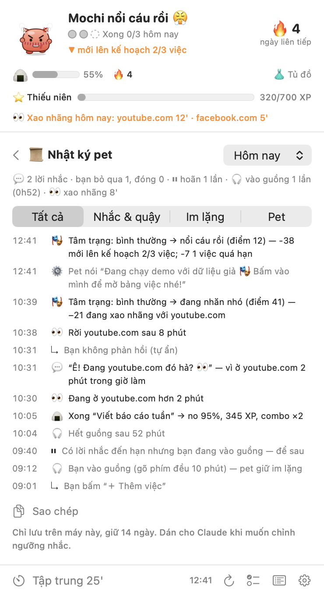

## Vì sao có những tính năng này

Hành vi của pet dựa trên các phương pháp năng suất phổ biến, cố tình giữ đơn giản:

- **Quy tắc 3 việc**: mỗi ngày chọn ba kết quả quan trọng thay vì một danh sách dài vô tận (J.D. Meier, *Getting Results the Agile Way*).
- **Ăn con ếch trước**: bắt đầu bằng việc quan trọng nhất (Brian Tracy).
- **Ý định thực hiện**: việc có giờ cụ thể ("14h mình sẽ…") dễ được làm hơn (Peter Gollwitzer). Pet nhắc bạn đúng giờ.
- **Pomodoro**: các phiên tập trung ngắn có hẹn giờ, xen kẽ nghỉ (Francesco Cirillo).
- **Bị gián đoạn rất tốn kém**: quay lại việc sau khi chuyển sang thứ khác mất khá lâu (nghiên cứu của Gloria Mark), nên pet nhắc khi bạn mở app hoặc trang web gây xao nhãng, và im lặng khi bạn tập trung hoặc đang họp.
- **Chặn lịch (time blocking)**: gắn cho việc một khung giờ trong lịch giúp giữ thời gian cho nó; pet tìm các khoảng trống giữa các cuộc họp.
- **Trì hoãn thường do việc quá to hoặc mơ hồ**: tách ra một bước đầu nhỏ, cụ thể sẽ dễ bắt tay vào hơn, nên pet gợi ý chia nhỏ những việc bạn cứ dời mãi.
- **Nghi thức kết thúc ngày**: khép lại ngày bằng cách xem lại và dời việc (Cal Newport).
- **Phản hồi cảm xúc**: một nhân vật phản ứng rõ ràng với tiến độ của bạn khiến việc hoàn thành có cảm giác được thưởng, còn lười thì hơi áy náy.
- **Chăm một con pet** ("hiệu ứng Tamagotchi", app Finch đang dùng): bạn làm việc một phần để pet được no và sạch, và hậu quả kéo dài qua nhiều ngày. Sợ mất thứ đang có thúc đẩy mạnh hơn mong được thêm.
- **Phần thưởng bất ngờ**: màn ăn mừng ngẫu nhiên và bánh vàng hiếm giữ được hứng thú lâu hơn phần thưởng cố định, nên game nào cũng dùng.

## Quyền riêng tư

- Không thu thập dữ liệu, không có máy chủ riêng. Kết nối mạng chỉ tới `api.todoist.com`, và tới `api.anthropic.com` khi bạn bấm **Nhờ Claude gợi ý** hoặc bật **Huấn luyện viên Claude** (khi đó tên việc, số việc và tên trang đang xao nhãng đi kèm mỗi lời nhắc Claude viết).
- Phát hiện xao nhãng đọc **tên app đang mở phía trước** và, nếu đó là trình duyệt, **địa chỉ và tiêu đề tab đang mở**. Chúng chỉ nằm trong bộ nhớ, không được lưu hay gửi đi đâu. Không cần quay màn hình hay quyền trợ năng.
- Thẻ **"Mình đang làm dở gì nhỉ?"** nhớ việc, ứng dụng, tiêu đề trang và địa chỉ (chỉ http/https, đã bỏ mọi thứ trông giống token hay phiên đăng nhập) bạn đang làm, cùng bước tiếp theo bạn ghim. Tất cả **chỉ nằm trong bộ nhớ**: không lưu, không ghi vào nhật ký, quên lúc nửa đêm. Cửa sổ ẩn danh không bao giờ được ghi nhớ, và **Cài đặt** có thể bỏ tiêu đề và địa chỉ ra khỏi thẻ.
- Hẹn **Bắt đầu khi…**, con ếch và lời nhắn cho ngày mai được lưu trong tuỳ chọn cục bộ của app tới khi ngày đó qua.
- Lịch được đọc ngay trên máy qua macOS (EventKit); sự kiện không rời khỏi máy bạn.
- Nhật ký "việc bị dời mãi" chỉ gồm mã việc và ngày, lưu trong cài đặt cục bộ của app. Đời sống của pet (độ no, XP, phụ kiện, số phút xao nhãng hôm nay theo từng trang) cũng lưu cục bộ như vậy.
- Giọng nói dùng giọng có sẵn của macOS, chạy offline.
- Phát hiện vắng mặt chỉ đọc "số giây từ lần gõ phím/di chuột cuối", không cần cấp quyền.

## Phát triển

```bash
scripts/build.sh                                    # build ra build/TodoPet.app
build/TodoPet.app/Contents/MacOS/TodoPet --selftest   # test logic (ngày giờ, đọc API, tâm trạng)
build/TodoPet.app/Contents/MacOS/TodoPet --demo       # chạy với dữ liệu mẫu
build/TodoPet.app/Contents/MacOS/TodoPet --snapshot out/  # xuất ảnh PNG các tâm trạng, bảng việc, bong bóng
```

Viết bằng Swift, SwiftUI và AppKit thuần, không thư viện ngoài, build bằng `swiftc`. Xem bảng cấu trúc file trong [README tiếng Anh](README.md#development).

## Giấy phép

[MIT](LICENSE)
